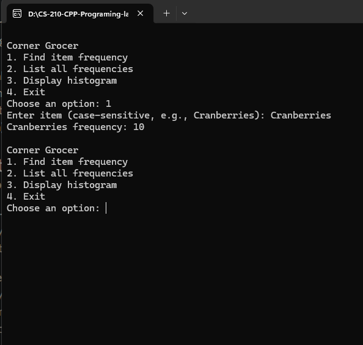
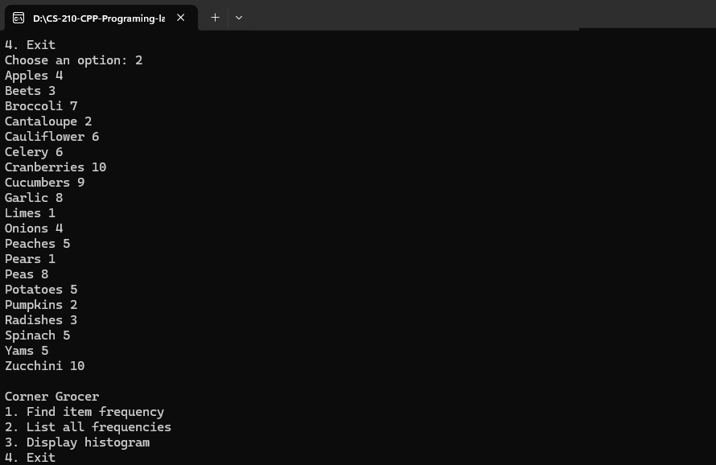
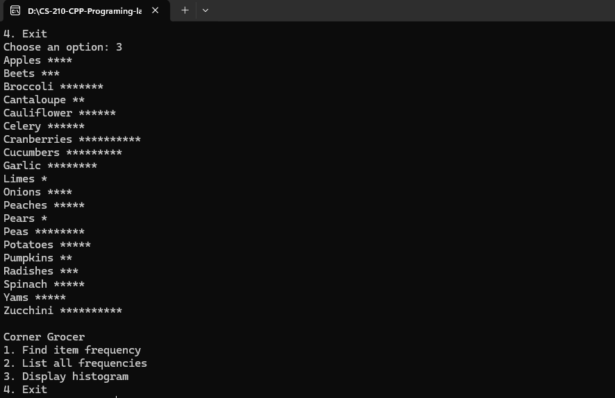

# CS 210 Portfolio — CornerGrocer

A C++ grocery-tracking application developed for CS 210: Programming Languages.

## Features

- Search for an item's purchase frequency.
- Display all item frequencies in alphabetical order.
- Display a histogram using one asterisk per purchase.
- Automatically generate the frequency.dat backup file.
- Validate menu choices and item-search input.
- Report input and backup file errors.

## Project Files

- main.cpp — Menu and user-input validation.
- GroceryTracker.h — Class declaration.
- GroceryTracker.cpp — File processing and reporting.
- CornerGrocer.slnx — Visual Studio solution.
- CornerGrocer.vcxproj — Visual Studio project configuration.
- CornerGrocer.vcxproj.filters — Visual Studio file organization.
- CS210_Project_Three_Input_File.txt — Grocery purchase records.
- Corner_Grocer_Documentation.docx — Design and functionality documentation.
- screenshots/ — Program output examples.

## Build and Run

1. Open CornerGrocer.vcxproj in Visual Studio with the Desktop development with C++ workload installed.
2. Select Debug and x64.
3. Build the project.
4. Run with Ctrl+F5.

Keep CS210_Project_Three_Input_File.txt in the project directory. The program uses relative file paths and creates frequency.dat in its working directory.

## Screenshots

### Item Search

### Frequency List

### Histogram

\## Project Reflection

\### Summarize the project and what problem it was solving.

CornerGrocer is a C++ application that analyzes grocery purchase records to help a store understand how frequently each item is purchased. Users can search for an item, display all purchase frequencies, or view a text-based histogram. The program automatically creates a backup file named `frequency.dat`. These reports help support decisions about produce placement.

\### What did you do particularly well?

I separated the grocery-tracking functionality from the menu logic using the `GroceryTracker` class. A private `std::map` stores item frequencies and keeps reports in alphabetical order. I also implemented input validation and exception handling to respond to invalid user input and file failures. Descriptive names, consistent formatting, and comments make the code easy to follow.

\### Where could you enhance your code? How would these improvements make your code more efficient, secure, and so on?

I could improve usability by supporting case-insensitive searches while preserving the original item names in reports. Automated tests could verify invalid menu input, unknown items, and file failures, helping prevent regressions when the program changes. For larger datasets, I could compare other data structures against `std::map` to evaluate lookup performance while considering the requirement for alphabetical reports.

\### Which pieces of the code did you find most challenging to write, and how did you overcome this? What tools or resources are you adding to your support network?

One challenging part was validating input so the program accepted only a single menu number or item name. I addressed this by reading complete lines with `std::getline` and parsing them with `std::istringstream`. This approach detects empty input, invalid menu values, and extra words without leaving unread characters in the input stream. I tested the program’s menu options in Visual Studio. My support resources include the Visual Studio debugger, course materials, and C++ Standard Library documentation.

\### What skills from this project will be particularly transferable to other projects or course work?

The most transferable skills are object-oriented design, file handling, input validation, exception handling, and using Standard Library containers. Separating responsibilities across source and header files will help me organize larger applications.

These skills also support my planned Raspberry Pi Suricata sensor project for my home Security Operations Center (SOC). Suricata will inspect mirrored network traffic and generate security records in an `eve.json` log. A separate processing tool could read those records, select alert events, and summarize them by alert signature, severity, or source IP. This follows a similar data-processing pattern to CornerGrocer: read records, organize information, and produce useful reports.

The project also taught me to handle missing files, detect processing failures, and keep reporting logic separate from data storage. Those practices will be useful when developing reliable security-log tools. I will build on my existing Splunk experience by learning to parse Suricata’s JSON events, process new records as they arrive, and handle log-file rotation.

\### How did you make this program maintainable, readable, and adaptable?

I organized the program into `main.cpp`, `GroceryTracker.h`, and `GroceryTracker.cpp`, separating user interaction from data processing. Descriptive names, consistent indentation, and focused comments explain the code’s purpose. Private data protects the frequency map, while `const` methods identify operations that do not modify the object.

Each method has a focused responsibility, such as finding an item’s frequency, printing a histogram, or writing a backup. Reporting methods accept an output stream, allowing the same frequency-report logic to write to both the console and a file. This organization reduces duplication and makes future changes easier to manage.

